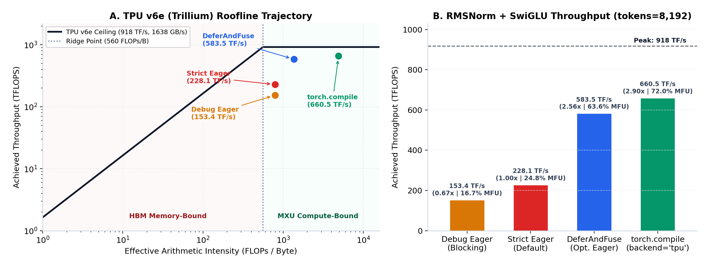
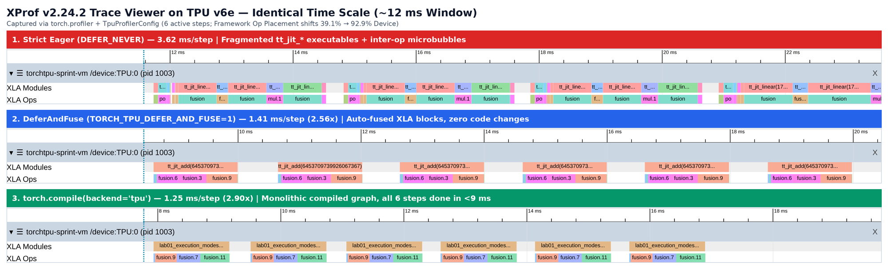
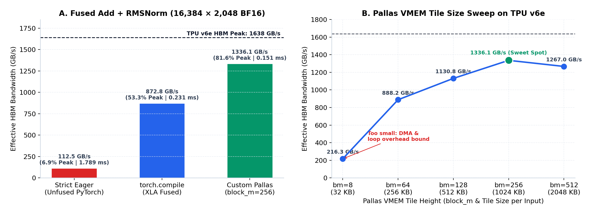

# Tensor-to-Silicon on TorchTPU (TPU v6e Trillium)

> **A Roofline-Guided Walkthrough of Execution Modes, XProf Profiling, and Custom Pallas Kernels on Cloud TPU v6e**
>
> 🌐 [English](README.md) | **한국어**

이 저장소는 **[TorchTPU](https://torchtpu.readthedocs.io/en/0.2.0/)** (`torch==2.15.0`, `torch-tpu==0.3.0`, `libtpu==0.0.53.1`, `xprof==2.24.2`)를 기반으로, 상위 PyTorch 실행 모드부터 하드웨어 정렬 최적화, `XProf` 프로파일링, 그리고 `torch.tpu.pallas` 커스텀 커널까지 단계별로 **Cloud TPU v6e (Trillium)** 성능을 끌어올리는 실측 워크스루 프로젝트입니다.

> **Acknowledgments**: 본 프로젝트와 Cloud TPU v6e 실측 실험은 **Google의 지원**을 받아 제작되었습니다.

---

## Key Measured Results on Cloud TPU v6e (`ct6e-standard-1t`)

* **4 Execution Modes (RMSNorm + SwiGLU, `tokens=8,192`)**: `Strict Eager` **228.1 TFLOPS** (24.8% MFU) → `DeferAndFuse` **583.5 TFLOPS** (**2.56×**, 코드 수정 없음) → `torch.compile(backend="tpu")` **660.5 TFLOPS** (**2.90×**, **72.0% MFU**)
* **XProf Profiling**: `Framework Op Placement` **39.1% → 92.9% Device**, 호스트 `cpu_op` 디스패치 **63% 감소** (`4,732 → 1,762`)
* **Bounded Dynamism (`128`-lane buckets)**: 증가하는 KV-Cache 디코딩 루프 `dynamic=False` (~127 ms/step) → `dynamic=None` (**0.53–0.55 ms/step**, **~240× 가속**)
* **v6e `256×256` MXU Alignment**: `3968` (`128×31`) **692.8 TFLOPS** → **`4096` (`256×16`) 766.7 TFLOPS (83.5% MFU)**
* **Custom Pallas Kernel (`torch.tpu.pallas.jax_op`, Fused Add+RMSNorm)**: `Strict Eager` **112.5 GB/s** → `torch.compile` **872.8 GB/s** → **`Custom Pallas (block_m=256)` 1,336.1 GB/s (v6e HBM 피크 1,638 GB/s의 81.6%, 11.8× 가속)**







* **Medium Article Draft (English)**: [`medium/medium_draft_en.md`](medium/medium_draft_en.md)

---

## 1. Target Hardware Specs: Cloud TPU v6e (Trillium, 1 Chip)

| 항목 | 스펙 (`ct6e-standard-1t` / Per Chip) | 최적화 시사점 |
| :--- | :--- | :--- |
| **Compute (TensorCore)** | 1 TensorCore (**2 × $256 \times 256$ MXU** + **VPU**) + SparseCore | v5e($128 \times 128$) 대비 MXU 행렬 크기가 2배(연산량 4배)로 확대됨 |
| **Peak `bfloat16` Compute** | **~918 TFLOPS** | `fp32` 행렬곱 시 `Precision.HIGH`(3-pass)/`HIGHEST`(6-pass)는 MXU 패스 비용 3~6배 발생 |
| **HBM Capacity & Bandwidth** | **32 GB** / **~1,638 GB/s** (~1.6 TB/s) | 작은 연산을 Eager로 쪼개 실행하면 HBM 왕복 트래픽과 PjRt 런치 오버헤드(Microbubbles)에 병목 |
| **Roofline Ridge Point** | **~560 FLOPs / Byte** (`918 TFLOPS / 1,638 GB/s`) | 매우 높은 Ridge Point 때문에 Operator Fusion(`DeferAndFuse`, `torch.compile`, `Pallas`) 효과가 극대화됨 |
| **Tile / Layout Alignment** | MXU **`256 × 256`**, 2D Register `(8, 128)`, Dynamic Bucket `128` | 배치·시퀀스·히든 차원을 **`256` 배수**(최소 `128` 배수)로 맞추고 `.contiguous()` 유지 |

---

## 2. 노트북 및 스크립트 구성

| 경로 | 설명 | 매핑되는 TorchTPU v0.2.0 문서 |
| :--- | :--- | :--- |
| [**`CLI_HANDSON_GUIDE.md`**](CLI_HANDSON_GUIDE.md) | **Step 0 ~ Step 8 터미널 복사·붙여넣기 전용 실습 런북** (로컬 터미널 / TPU VM 터미널 구분 표기) | 전체 워크스루 실행 가이드 |
| [`scripts/setup_v6e_vm.sh`](scripts/setup_v6e_vm.sh) | Ubuntu 22.04 Accelerator TPU v6e VM에서 Python 3.12 + `torch_tpu` + `xprof` + `jupyter` 원클릭 설치 스크립트 | [Get Started on a VM](https://torchtpu.readthedocs.io/en/0.2.0/get_started_on_a_vm/) |
| [`labs/lab01_execution_modes.py`](labs/lab01_execution_modes.py)<br>[`labs/lab02_shapes_memory_precision.py`](labs/lab02_shapes_memory_precision.py)<br>[`labs/lab03_custom_pallas_kernel.py`](labs/lab03_custom_pallas_kernel.py) | SSH 터미널에서 `python labs/lab0X_...py` 한 줄씩 바로 실행해 결과 표, Roofline `.png`, XProf 트레이스를 얻는 CLI 실습 스크립트 | Lab 01 ~ 03 전체 |
| [`notebooks/01_execution_modes_and_roofline.ipynb`](notebooks/01_execution_modes_and_roofline.ipynb) | • `torch.tpu.get_device_properties()` 및 TPU v6e Roofline 시각화<br>• 4대 실행 모드 비교: `Strict Eager`, `Debug Eager`, `DeferAndFuse`, `torch.compile(backend="tpu")`<br>• `torch.profiler` + `TpuProfilerConfig` 수집 및 `XProf` / `%tensorboard` 분석 | [Execution Model](https://torchtpu.readthedocs.io/en/0.2.0/torchtpu_execution_model/)<br>[Profiling with XProf](https://torchtpu.readthedocs.io/en/0.2.0/performance_profiling_with_xprof/) |
| [`notebooks/02_shapes_memory_and_precision.ipynb`](notebooks/02_shapes_memory_and_precision.ipynb) | • Dynamic Shape 재컴파일 방지 (`dynamic=False` vs `dynamic=None` 128-버킷 **Bounded Dynamism**)<br>• Contiguity 유지 및 PjRt View 임시 복사 제거<br>• 비정렬 vs `128` 정렬 vs **`256`(v6e MXU) 정렬** 비교 및 `bfloat16` / `torch.tpu.Precision` (1/3/6-pass) | [Dynamic Shapes](https://torchtpu.readthedocs.io/en/0.2.0/dynamic_shapes/)<br>[Memory Model](https://torchtpu.readthedocs.io/en/0.2.0/torchtpu_memory_model/)<br>[Numerical Precision](https://torchtpu.readthedocs.io/en/0.2.0/numerical_precision/) |
| [`notebooks/03_custom_pallas_kernels.ipynb`](notebooks/03_custom_pallas_kernels.ipynb) | • GPU Triton(SIMT 포인터) → TPU Pallas(2D `Ref` + `BlockSpec` VMEM 파이프라인) 멘탈 모델 전환<br>• 커스텀 Fused Residual + RMSNorm Pallas 커널(`block_m=256`) 작성 및 `torch.tpu.pallas.jax_op` 등록<br>• `nn.Module` + `torch.compile(backend="tpu")` 인라이닝 벤치마크 | [Custom Kernels](https://torchtpu.readthedocs.io/en/0.2.0/custom_kernels/)<br>[FLUX Case Study](https://torchtpu.readthedocs.io/en/0.2.0/case_studies_flux/) |

---

## 3. Cloud TPU v6e 생성 및 실행 가이드 (CLI & Colab 연결)

### Step 1. TPU v6e (`ct6e-standard-1t`) Flex-start VM 생성
```bash
gcloud compute instances create torchtpu-sprint-vm \
    --zone=us-east5-a \
    --machine-type=ct6e-standard-1t \
    --provisioning-model=FLEX_START \
    --request-valid-for-duration=2h \
    --max-run-duration=8h \
    --instance-termination-action=DELETE \
    --boot-disk-size=100GB \
    --image-project=ubuntu-os-accelerator-images \
    --image-family=ubuntu-accel-2204-amd64-tpu-v5e-v5p-v6e \
    --maintenance-policy=TERMINATE
```
> **참고**: 만약 재고 사정으로 4칩 머신(`ct6e-standard-4t`)을 할당받았다면, 실행 시 `export TPU_VISIBLE_DEVICES=0`을 설정해 단일 칩 모드로 동일하게 실습할 수 있습니다.

### Step 2. 코드 복사 및 포트 포워딩 SSH 접속
```bash
gcloud compute scp --recurse . torchtpu-sprint-vm:~/torchtpu-tensor-to-silicon --zone=us-east5-a
gcloud compute ssh torchtpu-sprint-vm --zone=us-east5-a -- -L 6006:localhost:6006 -L 8888:localhost:8888
```

### Step 3. VM 내부 환경 설치
```bash
cd ~/torchtpu-tensor-to-silicon
bash scripts/setup_v6e_vm.sh
source .venv/bin/activate
```

### Step 4. 실행 (CLI 직접 실행 또는 Colab 로컬 런타임 연결)
* **방법 A — CLI에서 실습 스크립트 실행 & XProf 열기**:
  ```bash
  LD_PRELOAD=/usr/lib/x86_64-linux-gnu/libtcmalloc_minimal.so.4 python labs/lab01_execution_modes.py
  xprof --logdir=outputs/xprof_modes --port=6006   # 로컬 브라우저 http://localhost:6006 접속
  ```
* **방법 B — Google Colab 웹 UI에서 이 v6e VM에 연결**:
  ```bash
  jupyter notebook --NotebookApp.allow_origin='https://colab.research.google.com' --port=8888 --NotebookApp.port_retries=0 --no-browser
  ```
  출력된 `http://localhost:8888/?token=...` URL을 Colab 우측 상단 **`연결 → 로컬 런타임에 연결`**에 입력한 뒤 노트북(2번 셀부터)을 실행합니다.

### Step 5. 실습 종료 후 인스턴스 삭제 (필수)
```bash
gcloud compute instances delete torchtpu-sprint-vm --zone=us-east5-a --quiet
```

---

## 감사의 글 (Acknowledgments)

본 프로젝트와 Cloud TPU v6e 실측 벤치마크는 **Google의 지원**을 받아 제작되었습니다.
