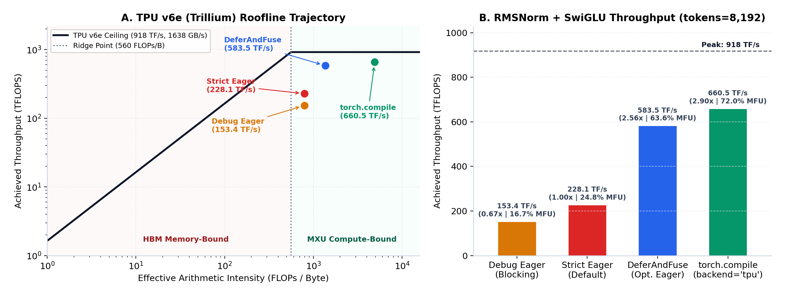
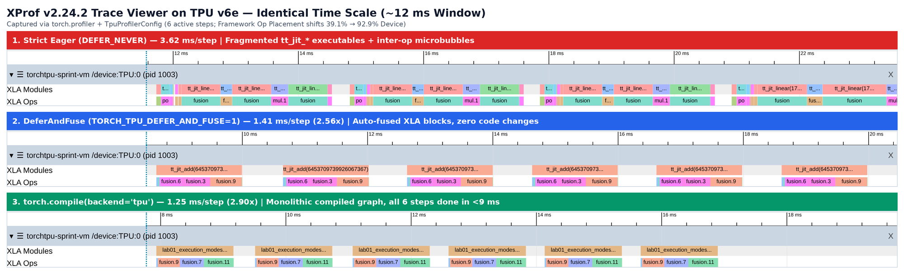
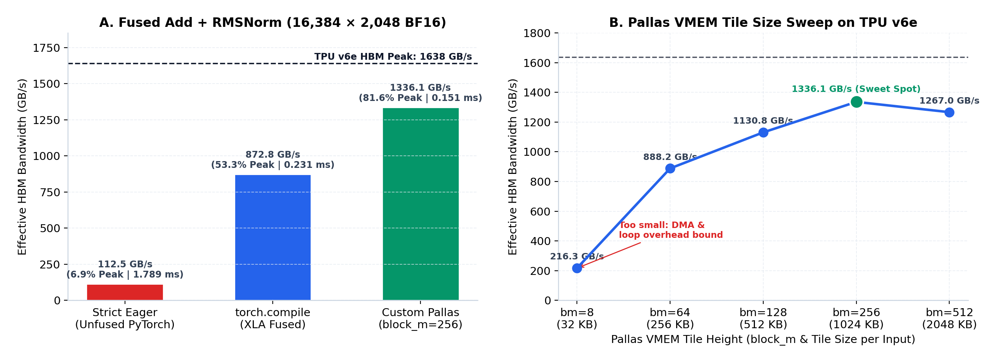

# Tensor-to-Silicon on TorchTPU (Cloud TPU v6e Trillium)

> **A Roofline-Guided Walkthrough of Execution Modes, XProf Profiling, and Custom Pallas Kernels on Cloud TPU v6e**
>
> 🌐 **English** | [한국어](README.ko.md)

This repository is a hands-on, measured walkthrough for optimizing native PyTorch workloads on **Cloud TPU v6e (Trillium)** using **[TorchTPU](https://torchtpu.readthedocs.io/en/0.2.0/)** (`torch==2.15.0`, `torch-tpu==0.3.0`, `libtpu==0.0.53.1`, `xprof==2.24.2`). Starting from high-level execution modes and Roofline analysis, it walks step-by-step through `XProf` hardware trace inspection, silicon-aware shape/memory/precision tuning, and custom VMEM-tiled `torch.tpu.pallas` kernels.

> **Acknowledgments:** This project and the live Cloud TPU v6e experiments were created with support from **Google**.

---

## Key Measured Results on Cloud TPU v6e (`ct6e-standard-1t`)

All numbers below were measured on a live single-chip Cloud TPU v6e (`ct6e-standard-1t`, `europe-west4-a`, `LD_PRELOAD=libtcmalloc_minimal.so.4`). Raw JSON metrics and logs are included under [`results_from_vm/outputs/`](results_from_vm/outputs/).

| Optimization Layer | Workload | Baseline | Optimized | Measured Gain |
| :--- | :--- | :--- | :--- | :--- |
| **Execution Mode** (`Lab 01`) | RMSNorm + SwiGLU (`8,192 × 4,096`, `bf16`) | `Strict Eager`: 3.616 ms (**228.1 TFLOPS**, 24.8% MFU) | `DeferAndFuse`: 1.413 ms (**583.5 TFLOPS**)<br>`torch.compile`: 1.248 ms (**660.5 TFLOPS**, **72.0% MFU**) | **2.56×** (zero code change)<br>**2.90×** (`torch.compile`) |
| **XProf Profiling** (`Lab 01`) | 6 active profiled steps | `Strict Eager`: 4,732 `cpu_op`s, **39.1%** Device Op Placement | `torch.compile`: 1,762 `cpu_op`s, **92.9%** Device Op Placement | **-63%** host dispatch overhead |
| **Bounded Dynamism** (`Lab 02`) | Growing KV-cache decode (`seq = 128 → 160`) | `dynamic=False`: ~127 ms/step (recompiles every step) | `dynamic=None` (128-lane buckets): **0.53–0.55 ms/step** | **~240×** steady-state speedup |
| **v6e `256×256` MXU Alignment** (`Lab 02`) | `bfloat16` GEMM (`8,192 × D × D`) | `D = 3968` (`128 × 31`): **692.8 TFLOPS** (75.5% MFU) | `D = 4096` (`256 × 16`): **766.7 TFLOPS (83.5% MFU)** | **+10.7%** TFLOPS from 256-alignment |
| **Custom Pallas Kernel** (`Lab 03`) | Fused Residual Add + RMSNorm (`8,192 × 4,096`) | `Strict Eager`: **112.5 GB/s**<br>`torch.compile`: **872.8 GB/s** (53.3% peak) | `torch.tpu.pallas.jax_op` (`block_m=256`): **1,336.1 GB/s (81.6% of 1,638 GB/s HBM peak)** | **11.8×** vs. Strict Eager<br>**1.53×** vs. XLA Auto-Fused |







* **Full Technical Article Draft (Medium, English):** [`medium/medium_draft_en.md`](medium/medium_draft_en.md)

---

## 1. Target Hardware Specs: Cloud TPU v6e (Trillium, 1 Chip)

| Specification | Cloud TPU v6e (`ct6e-standard-1t`) | Optimization Takeaway |
| :--- | :--- | :--- |
| **Compute (TensorCore)** | 1 TensorCore (**2 × $256 \times 256$ MXU** + **VPU**) + SparseCore | MXU matrix width doubles over v5e ($128 \times 128$), yielding 4× FLOPs per cycle |
| **Peak `bfloat16` Compute** | **~918 TFLOPS** | Native `bfloat16` is 1-pass; `fp32` matmuls with `Precision.HIGH` (3-pass) / `HIGHEST` (6-pass) trade throughput for precision |
| **HBM Capacity & Bandwidth** | **32 GB** / **~1,638 GB/s** (~1.6 TB/s) | Fragmented Eager execution stalls on HBM round-trips and PjRt launch microbubbles |
| **Roofline Ridge Point** | **~560 FLOPs / Byte** (`918 TFLOPS / 1,638 GB/s`) | High ridge point makes operator fusion (`DeferAndFuse`, `torch.compile`, `Pallas`) critical |
| **Tile / Layout Alignment** | MXU **`256 × 256`**, 2D VPU `(8, 128)`, Dynamic Bucket `128` | Align batch/sequence/hidden dims to multiples of **`256`** (minimum `128`) and keep compiled inputs `.contiguous()` |

---

## 2. Repository Structure

| Path | Description | Corresponding TorchTPU Docs |
| :--- | :--- | :--- |
| [`labs/lab01_execution_modes.py`](labs/lab01_execution_modes.py)<br>[`labs/lab02_shapes_memory_precision.py`](labs/lab02_shapes_memory_precision.py)<br>[`labs/lab03_custom_pallas_kernel.py`](labs/lab03_custom_pallas_kernel.py) | Standalone CLI benchmark scripts covering execution modes + XProf traces, dynamic shapes + MXU alignment + precision, and custom Pallas VMEM kernels | Labs 01–03 (end-to-end) |
| [`notebooks/01_execution_modes_and_roofline.ipynb`](notebooks/01_execution_modes_and_roofline.ipynb) | Interactive notebook: TPU v6e Roofline plot, 4 execution modes (`Debug Eager`, `Strict Eager`, `DeferAndFuse`, `torch.compile`), and `XProf` trace collection | [Execution Model](https://torchtpu.readthedocs.io/en/0.2.0/torchtpu_execution_model/)<br>[Profiling with XProf](https://torchtpu.readthedocs.io/en/0.2.0/performance_profiling_with_xprof/) |
| [`notebooks/02_shapes_memory_and_precision.ipynb`](notebooks/02_shapes_memory_and_precision.ipynb) | Interactive notebook: `dynamic=False` vs. `dynamic=None` (128-bucket Bounded Dynamism), contiguity overhead, `256×256` MXU alignment, and `bfloat16` / `torch.tpu.Precision` | [Dynamic Shapes](https://torchtpu.readthedocs.io/en/0.2.0/dynamic_shapes/)<br>[Memory Model](https://torchtpu.readthedocs.io/en/0.2.0/torchtpu_memory_model/)<br>[Numerical Precision](https://torchtpu.readthedocs.io/en/0.2.0/numerical_precision/) |
| [`notebooks/03_custom_pallas_kernels.ipynb`](notebooks/03_custom_pallas_kernels.ipynb) | Interactive notebook: Triton (SIMT) → Pallas (`Ref` + `BlockSpec` VMEM pipeline) mental model, custom Fused Add+RMSNorm kernel (`torch.tpu.pallas.jax_op`), tile sweep, and `torch.compile` inlining | [Custom Kernels](https://torchtpu.readthedocs.io/en/0.2.0/custom_kernels/)<br>[FLUX Case Study](https://torchtpu.readthedocs.io/en/0.2.0/case_studies_flux/) |
| [`scripts/setup_v6e_vm.sh`](scripts/setup_v6e_vm.sh) | One-click installer for Python 3.12 (`uv`), `torch`, `torch-tpu`, `xprof`, and `jupyter` on an Ubuntu 22.04 Accelerator TPU v6e VM | [Get Started on a VM](https://torchtpu.readthedocs.io/en/0.2.0/get_started_on_a_vm/) |
| [`scripts/generate_medium_figures.py`](scripts/generate_medium_figures.py) | Reproduces the publication-quality charts in [`medium/figures/`](medium/figures/) from the measured JSONs in [`results_from_vm/outputs/`](results_from_vm/outputs/) | — |
| [`medium/medium_draft_en.md`](medium/medium_draft_en.md) | Complete English technical article draft with all measured tables, code snippets, and embedded figures | — |
| [`CLI_HANDSON_GUIDE.md`](CLI_HANDSON_GUIDE.md) | Copy-and-paste step-by-step CLI runbook (Korean) from GCP Flex-Start VM provisioning to cleanup | Full hands-on guide |

---

## 3. Quickstart on Cloud TPU v6e (Flex-Start CLI & Colab)

### Step 1. Provision a Cloud TPU v6e (`ct6e-standard-1t`) Flex-Start VM
```bash
export ZONE="europe-west4-a"   # or us-east5-a / us-central1-a depending on quota
export VM_NAME="torchtpu-sprint-vm"

gcloud compute instances create "$VM_NAME" \
    --zone="$ZONE" \
    --machine-type=ct6e-standard-1t \
    --provisioning-model=FLEX_START \
    --request-valid-for-duration=2h \
    --max-run-duration=8h \
    --instance-termination-action=DELETE \
    --boot-disk-size=100GB \
    --image-project=ubuntu-os-accelerator-images \
    --image-family=ubuntu-accel-2204-amd64-tpu-v5e-v5p-v6e \
    --maintenance-policy=TERMINATE
```
> **Note:** If you provision a 4-chip VM (`ct6e-standard-4t`), set `export TPU_VISIBLE_DEVICES=0` to run all single-chip labs identically.

### Step 2. Copy the Repository & SSH with Port Forwarding
```bash
gcloud compute scp --recurse . "$VM_NAME":~/torchtpu-tensor-to-silicon --zone="$ZONE"
gcloud compute ssh "$VM_NAME" --zone="$ZONE" -- -L 6006:localhost:6006 -L 8888:localhost:8888
```

### Step 3. Install Python 3.12 + TorchTPU Inside the TPU VM
```bash
cd ~/torchtpu-tensor-to-silicon
bash scripts/setup_v6e_vm.sh
source .venv/bin/activate
```

### Step 4. Run Labs & Inspect Traces in XProf (or Connect via Colab)
* **Option A — Run the CLI Labs & Launch XProf:**
  ```bash
  export LD_PRELOAD=/usr/lib/x86_64-linux-gnu/libtcmalloc_minimal.so.4

  python labs/lab01_execution_modes.py
  python labs/lab02_shapes_memory_precision.py
  python labs/lab03_custom_pallas_kernel.py

  # Open http://localhost:6006 in your local browser
  xprof --logdir=outputs/xprof_modes --port=6006
  ```
* **Option B — Connect Google Colab UI to the TPU v6e VM (Local Runtime):**
  ```bash
  jupyter notebook \
      --NotebookApp.allow_origin='https://colab.research.google.com' \
      --port=8888 --NotebookApp.port_retries=0 --no-browser
  ```
  Paste the printed `http://localhost:8888/?token=...` URL into Google Colab via **Connect ▾ → Connect to a local runtime**, then open any notebook in `notebooks/`.

### Step 5. Clean Up the VM When Finished
Flex-Start instances do not support `stop`; delete the VM immediately once you download `outputs/`:
```bash
gcloud compute instances delete "$VM_NAME" --zone="$ZONE" --quiet
```

---

## Acknowledgments

This project and all live Cloud TPU v6e experiments were made possible with support from **Google**.
