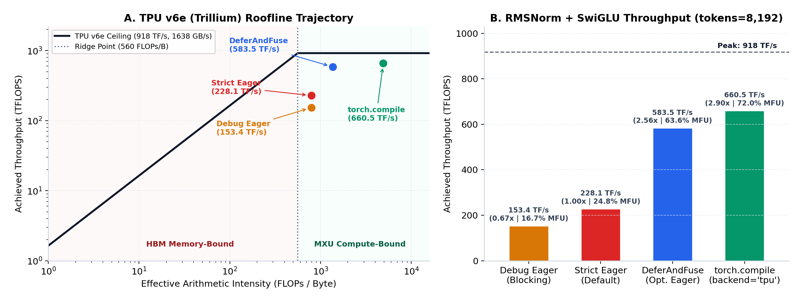
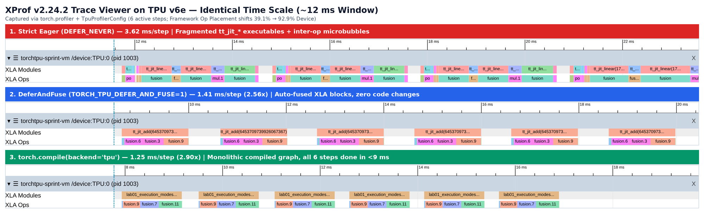
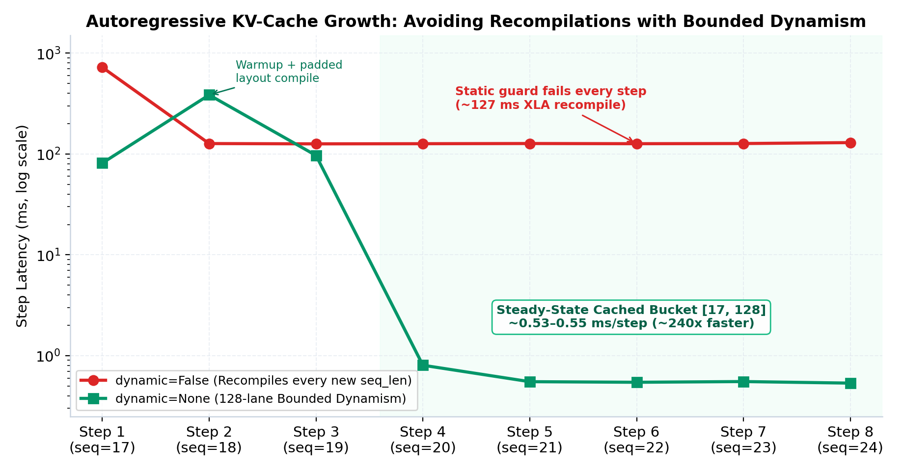
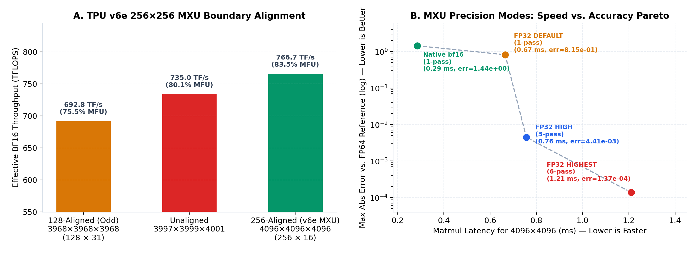
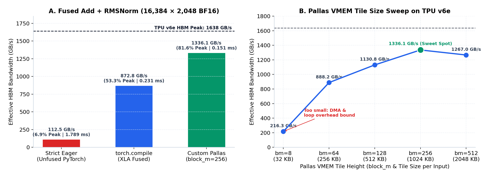

# Tensor-to-Silicon on TorchTPU: A Roofline-Guided Walkthrough of Execution Modes, XProf Profiling, and Custom Pallas Kernels on TPU v6e

*How to go from 228 TFLOPS (25% MFU) to 660+ TFLOPS and 1,336 GB/s HBM throughput on Cloud TPU v6e (Trillium) using native PyTorch—without leaving your PyTorch workflow.*

---

> **About This Walkthrough**
> If you want a conceptual deep dive into why the Memory Wall happens and how OpenXLA's compiler performs operator fusion under the hood, I recommend reading Park Chansung's great GDE article, [*PyTorch × TPU (TorchTPU & OpenXLA): Compiler Internals and Operator Fusion Optimization*](https://medium.com/google-developer-experts/pytorch-tpu-torchtpu-openxla-compiler-internals-and-operator-fusion-optimization-05b95cb27f66).
>
> **This post picks up where theory ends.** Every chart, latency table, profiler trace, and kernel sweep below was measured directly on a live **Google Cloud TPU v6e (Trillium)** chip using **TorchTPU** (`torch==2.15.0`, `torch-tpu==0.3.0`, `libtpu==0.0.53.1`, `xprof==2.24.2`). Together, we will walk all the way from high-level execution modes and XProf diagnostics down to hardware-aligned tensor layouts and custom `torch.tpu.pallas` kernels—bridging GPU Triton mental models to native TPU silicon.

---

## 1. Know Your Silicon First: The TPU v6e (Trillium) Roofline

Before touching a single compiler flag, we need a quantitative map of the hardware ceiling. Unlike legacy `torch_xla`, **TorchTPU** registers directly via PyTorch's `PrivateUse1` backend—meaning you can initialize a TPU and query its hardware capabilities using standard PyTorch idioms:

```python
import torch

device = torch.device("tpu")
props = torch.tpu.get_device_properties(device)

peak_tflops = props.bf16_flops_per_device / 1e12     # 918.0 TFLOPS
hbm_gib = props.hbm_bytes_per_device / (1024 ** 3)   # 32.00 GiB
peak_bw_gbs = 1638.0                                 # TPU v6e HBM bandwidth (~1.6 TB/s)
ridge_point = (peak_tflops * 1e12) / (peak_bw_gbs * 1e9)  # 560.4 FLOPs / Byte
```

Look closely at that **Ridge Point: `560.4 FLOPs/Byte`**.

Compared to TPU v5e (`197 TFLOPS`, `819 GB/s`, Ridge Point `~240 FLOPs/Byte`), **TPU v6e (Trillium)** increased BF16 compute by **4.7×** while doubling HBM bandwidth—and doubled each systolic array (**MXU**) from `128×128` to **`256×256`**.

That architectural shift has an immediate, brutal consequence for PyTorch code:
**Any workload whose effective Arithmetic Intensity sits below 560 FLOPs/Byte is starving two massive `256×256` MXUs while waiting on HBM.** Every unnecessary memory round-trip, host launch microbubble, or unaligned tile hurts far more on Trillium than on earlier generations.

> **Practical Host Tip (`tcmalloc`):** When running TorchTPU on Linux, glibc's default `ptmalloc` can cause host-thread allocator contention and trigger a TorchTPU performance warning. Preloading `libtcmalloc_minimal.so.4` (`LD_PRELOAD=/usr/lib/x86_64-linux-gnu/libtcmalloc_minimal.so.4`) removes that host bottleneck before we even begin benchmarking.

---

## 2. Comparing TorchTPU's 4 Execution Modes on a Real Transformer Block

To see how execution configuration moves a workload across the TPU v6e Roofline, let's benchmark a realistic **RMSNorm + SwiGLU FFN** block (`B=16, S=512, D=2048, FFN=8192`, `tokens=8,192`, `bfloat16`)—a classic mix of memory-bound VPU reductions (`RMSNorm`, `SiLU`, residual add) and compute-heavy MXU matrix multiplications (`w_gate`, `w_up`, `w_down`):

```python
class RMSNormSwiGLUBlock(nn.Module):
    def __init__(self, hidden_dim: int = 2048, ffn_dim: int = 8192):
        super().__init__()
        self.weight = nn.Parameter(torch.ones(hidden_dim))
        self.w_gate = nn.Linear(hidden_dim, ffn_dim, bias=False)
        self.w_up = nn.Linear(hidden_dim, ffn_dim, bias=False)
        self.w_down = nn.Linear(ffn_dim, hidden_dim, bias=False)

    def forward(self, x: torch.Tensor) -> torch.Tensor:
        rms = torch.rsqrt(x.float().pow(2).mean(dim=-1, keepdim=True) + 1e-6).to(x.dtype)
        h = x * rms * self.weight
        activated = F.silu(self.w_gate(h)) * self.w_up(h)
        return x + self.w_down(activated)
```

TorchTPU provides **four distinct execution modes** along the compile-time vs. runtime trade-off spectrum, switchable cleanly via `torch.tpu.set_eager_mode(...)` or `torch.compile(..., backend="tpu")`:

1. **Debug Eager (`EagerMode.DEFER_NEVER_AND_LAUNCH_BLOCKING` / `TORCH_TPU_LAUNCH_BLOCKING=1`):** Runs one op at a time in strict CPU–TPU lockstep. Essential for pinning down stack traces and out-of-bounds bugs (especially paired with `TORCH_TPU_ENABLE_DEBUG_CHECKS=1`), never for benchmarking.
2. **Strict Eager (`EagerMode.DEFER_NEVER`, default):** Dispatches individual ATen ops asynchronously using fast `-O1` compilation. Great time-to-first-result, but small VPU ops suffer from PJRT dispatch latency (~50 µs "microbubbles") and repeated HBM round-trips.
3. **DeferAndFuse (`EagerMode.DEFER_AND_FUSE` / `TORCH_TPU_DEFER_AND_FUSE=1`):** A hybrid "optimized eager" mode. TorchTPU buffers `DeferredOp`s in the stream until a sync or loop repetition is detected, then compiles fused `-O2` chunks on the fly—**with zero changes to your model code**.
4. **`torch.compile(backend="tpu")`:** Captures the full FX graph via TorchDynamo, lowers to StableHLO, and compiles a single `-O2` XLA executable that bypasses deferred-op queuing altogether.

### Measured Results on TPU v6e (`ct6e-standard-1t`)

| Execution Mode | Latency (ms) | Achieved TFLOPS | Speedup vs. Strict | MFU (% of 918 TF/s) |
| :--- | ---: | ---: | ---: | ---: |
| **Debug Eager** (`LAUNCH_BLOCKING`) | 5.375 | 153.42 | 0.67× | 16.7% |
| **Strict Eager** (`DEFER_NEVER`) | 3.616 | 228.07 | 1.00× | 24.8% |
| **DeferAndFuse** (`DEFER_AND_FUSE`) | 1.413 | 583.54 | **2.56×** | 63.6% |
| **`torch.compile(backend="tpu")`** | **1.248** | **660.52** | **2.90×** | **72.0%** |



Two takeaways jump straight off the chart:
- **DeferAndFuse is a massive free lunch for dynamic/imperative codebases.** Without wrapping a single function in `torch.compile`, flipping `TORCH_TPU_DEFER_AND_FUSE=1` jumped throughput **2.56×** (from 228.1 to 583.5 TFLOPS).
- **`torch.compile(backend="tpu")` pushes the block to 660.5 TFLOPS (72.0% MFU)**—nearly **3× faster** than default eager—by eliminating host dispatch friction and fusing the entire forward pass.

---

## 3. Don't Guess—Verify with `torch.profiler` and XProf

Modern TorchTPU integrates natively with `torch.profiler` (PyTorch 2.12+). Passing `ProfilerActivity.TPU` alongside `TpuProfilerConfig` writes standard `.xplane.pb` traces directly readable by **XProf**:

```python
from torch.tpu.profiler import TpuProfilerConfig

tpu_cfg = TpuProfilerConfig(host_tracer_level=2, device_tracer_level=1, run_dir=out_dir)

with torch.profiler.profile(
    activities=[torch.profiler.ProfilerActivity.CPU, torch.profiler.ProfilerActivity.TPU],
    schedule=torch.profiler.schedule(wait=2, warmup=2, active=6, repeat=1),
    experimental_config=tpu_cfg,
    on_trace_ready=torch.profiler.tensorboard_trace_handler(str(out_dir)),
) as prof:
    for _ in range(10):
        _ = fn(x)
        torch.accelerator.synchronize()
        prof.step()
```

### What the Captured Traces Actually Reveal (6 Active Steps)

Inspecting the captured profiler traces across the exact same 6 active steps explains *mechanically* where the 2.9× speedup came from:

| Profiled Mode (6 Steps) | Total Trace Events | Host `cpu_op` Dispatches | Device Kernel Events | Representative Compiled Executables |
| :--- | ---: | ---: | ---: | :--- |
| **`strict_eager`** | 5,012 | 4,732 | 186 | `tt_jit_pow`, `tt_jit_mean`, `tt_jit_add`, `tt_jit_rsqrt`, `tt_jit_linear` (each separate!) |
| **`defer_and_fuse`** | 2,424 | 2,206 (**-53%**) | 120 | Fused `tt_jit_add` + `%multiply_reduce_fusion` + async `S(1)` VMEM `%copy-start` |
| **`torch_compile`** | 1,960 | 1,762 (**-63%**) | 108 | Single `lab01_execution_modes_L30_split0_fwd` (1 launch/step) + async `S(1)` DMA |



Look at what the real **XProf v2.24.2 Trace Viewer** shows when all three runs are aligned to the **exact same ~12 ms horizontal window**:
- **Row 1 (`Strict Eager`)**: Only ~3.5 iterations finish in 12 ms. Every single step fragments into ~10 separate `tt_jit_*` executables separated by inter-op dispatch gaps, leaving XProf's Overview **Framework Op Placement** at **60.9% Host / 39.1% Device**.
- **Row 2 (`DeferAndFuse`)**: With zero model edits, all 6 iterations fit inside ~11.4 ms as TorchTPU auto-fuses each step into a single `tt_jit_add(...)` XLA module containing just 3 dense ops (`fusion.6`, `fusion.3`, `fusion.9`). Notice, however, the small inter-step white gaps while the deferred-op stream analyzes and dispatches each iteration.
- **Row 3 (`torch.compile(backend="tpu")`)**: All 6 iterations finish in **under 9 ms**—collapsing each step into one monolithic `lab01_execution_modes_L30_split0_fwd` executable (`fusion.9`, `fusion.7`, `fusion.11`), tightening the inter-step host enqueue gap, and shifting **Framework Op Placement** to **7.1% Host / 92.9% Device**!

And peeking inside our HLO IR dump (`XLA_FLAGS="--xla_dump_hlo_as_text"`) confirms the exact TPU silicon semantics behind those fused traces:

```text
%copy-start = (bf16[8192,2048]{1,0:T(8,128)(2,1)S(1)}, bf16[8192,2048]{1,0:T(8,128)(2,1)})
%multiply_reduce_fusion = f32[16,512]{1,0:T(8,128)S(1)} fusion(...)
```

- **`T(8,128)(2,1)`**: Hardware 2D register tiling (`8×128` sublanes/lanes with `bf16` 2-to-1 packing).
- **`S(1)`**: TPU on-chip **VMEM** memory space! Under `Strict Eager`, individual `-O1` executables write back to HBM (`S(0)`). Under `DeferAndFuse` and `torch.compile`, XLA's `-O2` memory-space assignment schedules asynchronous HBM ↔ VMEM DMA transfers (`%copy-start` / `%copy-done`) overlapped directly with MXU compute.

---

## 4. Hardware-Aware PyTorch Tuning: 4 Practical Techniques Measured on v6e

Even with `torch.compile(backend="tpu")`, four subtle PyTorch habits can silently wreck performance. Here is how each one behaves when measured directly on TPU v6e.

### 4.1 Avoiding Dynamic-Shape Recompilations with Bounded Dynamism (`128`-Lane Buckets)

Consider an autoregressive LLM decode loop where `torch.cat([kv_cache, new_kv], dim=2)` grows the KV cache sequence length by 1 token per step (`seq = 17, 18, 19, ...`).

- With **`dynamic=False`**, TorchDynamo guards on the exact sequence length. Every single generated token invalidates the guard and triggers a full **~127 ms XLA recompilation**.
- With **`dynamic=None`** (TorchTPU's default **Bounded Dynamism**), TorchDynamo marks the changing axis as a `torch.SymInt`, and TorchTPU compiles a bounded executable padded up to the next multiple of **`128`** (matching the TPU's 128-lane hardware tile).



| Decode Step (`seq_len`) | `dynamic=False` (ms) | `dynamic=None` (128-bucket, ms) | What Happened |
| :--- | ---: | ---: | :--- |
| Step 1 (`seq=17`) | 724.18 | 81.23 | Initial static compile |
| Step 2 (`seq=18`) | 126.93 | 385.37 | Dynamo detects changing dim → compiles `[17, 128]` bucket |
| Step 3 (`seq=19`) | 126.05 | 96.78 | Compiles steady-state XLA padded output layout |
| **Steps 4–8 (`seq=20..24`)** | **126.5 – 129.7** | **0.53 – 0.55** | **~240× faster! Zero recompilations inside bucket** |

### 4.2 Keeping Tensors Contiguous at `torch.compile` Boundaries

On CUDA, `.transpose()` or `.as_strided()` is essentially a zero-cost metadata view because kernels dynamically compute 1D pointer offsets per thread. On TPU, memory is physically laid out in 2D register-aligned tiles (`T(8,128)`), and PJRT expects **contiguous, zero-offset** buffers at compiled function boundaries. Passing a non-contiguous view into a compiled function forces TorchTPU to materialize a temporary contiguous copy in eager mode before dispatch.

On a single large `4096×4096` matmul (`gelu(x @ w)`), we measured `0.328 ms` with a non-contiguous `base.t()` input vs. `0.319 ms` with `.contiguous()` (~9 µs overhead per call). While a single large MXU matmul easily hides a 9 µs copy, chaining many smaller compiled layers with non-contiguous views across boundaries quickly compounds into unnecessary HBM traffic—so call `.contiguous()` once before entering hot compiled loops.

### 4.3 Aligning Shapes to TPU v6e's `256×256` MXU (Not Just `128`!)

Most TPU guides tell you to align matrix dimensions to multiples of `128`. That was optimal for TPU v4/v5e (`128×128` MXUs)—**but TPU v6e upgraded to `256×256` MXUs.**

Let's test a `bfloat16` matmul at three nearby shapes on Trillium:
- **`3968 × 3968 × 3968`** (`128 × 31` — an *odd* multiple of 128, leaving the final `256×256` MXU tile half-empty!)
- **`3997 × 3999 × 4001`** (unaligned)
- **`4096 × 4096 × 4096`** (`256 × 16` — cleanly fills every `256×256` MXU tile)

### 4.4 Managing `bfloat16` and MXU Multi-Pass Precision (`torch.tpu.Precision`)

TPU MXUs natively multiply `bfloat16` inputs and accumulate in `float32`. When you pass `float32` tensors to `torch.matmul`, `torch.tpu.precision(...)` controls how many `bf16` polynomial passes the MXU executes:

- `Precision.DEFAULT` (`"medium"`, **1-pass**): Truncates `fp32` inputs to `bf16` (8-bit significand) on the MXU—fast, but pays 2× HBM traffic compared to native `bf16` tensors.
- `Precision.HIGH` (`"high"`, **3-pass**): Splits `fp32` into high/low `bf16` halves and executes 3 MXU cross-terms (~16-bit significand).
- `Precision.HIGHEST` (`"highest"`, **6-pass**): Splits into 3 components and executes 6 MXU cross-terms to approximate full IEEE-754 `fp32`.



| Experiment / Mode (`4096×4096` Matmul) | Latency (ms) | Effective TFLOPS | Max Abs Error (vs. FP64) |
| :--- | ---: | ---: | ---: |
| **MXU Alignment (`bf16`):** `3968` (`128×31`) | 0.180 | 692.8 (75.5% MFU) | — |
| **MXU Alignment (`bf16`):** `3997×3999×4001` | 0.174 | 735.0 (80.1% MFU) | — |
| **MXU Alignment (`bf16`):** **`4096` (`256×16`)** | **0.179** | **766.7 (83.5% MFU)** | — |
| **Precision:** `Native bfloat16` (1-pass) | **0.285** | **481.4** | `1.44e+00` |
| **Precision:** `FP32 Precision.DEFAULT` (1-pass) | 0.665 | 206.6 | `8.15e-01` |
| **Precision:** **`FP32 Precision.HIGH` (3-pass)** | **0.757** | **181.5** | **`4.41e-03`** *(185× cleaner!)* |
| **Precision:** `FP32 Precision.HIGHEST` (6-pass) | 1.210 | 113.6 | `1.37e-04` *(4.2× slower than bf16)* |

Look at two non-obvious empirical findings from Figure 3:
1. **On TPU v6e, `256`-alignment matters:** `4096` (`256×16`) hits **766.7 TFLOPS (83.5% MFU)**—beating the odd `128`-multiple (`3968`) by **+10.7%**.
2. **If you already pay the HBM cost of `fp32` weights/activations, `Precision.HIGH` (3-pass) is the clear Pareto winner:** compared to `FP32 DEFAULT`, it cuts max numerical error by **185×** (`0.815 → 0.0044`) for only a **+14% latency increase** (`0.665 ms → 0.757 ms`), because HBM transfer time dominates the `fp32` 1-pass baseline! Conversely, for standard training/inference, keeping tensors in **native `bfloat16`** is **2.3× faster** than even 1-pass `fp32`.

---

## 5. Going Below the Compiler: Bridging GPU Triton to Custom `torch.tpu.pallas` Kernels

When `torch.compile` still leaves HBM bandwidth on the table—or when you need a bespoke fused op—TorchTPU lets you drop down to **Pallas** and register it as a first-class PyTorch operator via `torch.tpu.pallas.jax_op`.

If you have written GPU kernels in **Triton**, you don't need to learn the broader JAX framework—treat Pallas strictly as a thin TPU kernel DSL and map your mental model like this:

| Concept | GPU **Triton** (`@triton.jit`) | TPU **Pallas + TorchTPU** (`torch.tpu.pallas.jax_op`) |
| :--- | :--- | :--- |
| **Execution Grid** | `tl.program_id(axis)` (SIMT thread blocks) | `grid=(...)` + `index_map` (TensorCore tile pipeline) |
| **Memory Movement** | Arbitrary 1D pointer arithmetic (`tl.load(ptr + offs, mask)`) | Structured **DMA prefetch** via `BlockSpec(block_shape, index_map)` (HBM → **VMEM**) |
| **Compute Model** | Per-thread registers / Tensor Cores | Explicit 2D tile loads (`x_ref[...]`) on **VPU** (`fp32`) & **MXU** (`256×256` `bf16`) |
| **Alignment Rules** | Powers of 2 recommended | Last two tile dims divisible by **`(8, 128)`** (or full axis); **`256`** ideal on v6e |
| **PyTorch Hook** | Direct Python wrapper | `torch.tpu.pallas.jax_op("pallas::op", fn)` — works in Eager & `torch.compile`! |

### Writing a VMEM-Resident Fused Residual + RMSNorm Kernel

To test this on TPU v6e, let's fuse `x + residual` and `RMSNorm` (`16,384 × 2,048` `bf16` tensors) into a single HBM pass. Each `BlockSpec` streams a `(block_m, 2048)` tile from HBM into on-chip VMEM, promotes to `float32` on the VPU, computes the residual sum + mean-square reduction + scaling without ever touching HBM again, and writes only the final `bf16` tile back:

```python
import jax
import jax.numpy as jnp
from jax.experimental import pallas as pl
import torch

def _fused_add_rmsnorm_kernel(x_ref, res_ref, w_ref, o_ref):
    x_f32 = x_ref[...].astype(jnp.float32)
    res_f32 = res_ref[...].astype(jnp.float32)
    w_f32 = w_ref[...].astype(jnp.float32)  # shape: (1, D)

    h = x_f32 + res_f32
    rms = jax.lax.rsqrt(jnp.mean(jnp.square(h), axis=-1, keepdims=True) + 1e-6)
    o_ref[...] = (h * rms * w_f32).astype(o_ref.dtype)

def _fused_add_rmsnorm_jax(x: jax.Array, residual: jax.Array, weight_2d: jax.Array) -> jax.Array:
    num_rows, hidden_dim = x.shape
    block_m = 256  # 1,024 KB/tile in VMEM, aligned to both (8, 128) VPU & v6e 256 boundaries
    return pl.pallas_call(
        _fused_add_rmsnorm_kernel,
        out_shape=jax.ShapeDtypeStruct(x.shape, x.dtype),
        grid=(num_rows // block_m,),
        in_specs=[
            pl.BlockSpec((block_m, hidden_dim), lambda i: (i, 0)),
            pl.BlockSpec((block_m, hidden_dim), lambda i: (i, 0)),
            pl.BlockSpec((1, hidden_dim), lambda i: (0, 0)),
        ],
        out_specs=pl.BlockSpec((block_m, hidden_dim), lambda i: (i, 0)),
    )(x, residual, weight_2d)

# Expose as a native PyTorch TPU operator (compatible with Eager AND torch.compile)
fused_add_rmsnorm_pallas = torch.tpu.pallas.jax_op(
    "pallas::fused_add_rmsnorm",
    _fused_add_rmsnorm_jax,
)
```

### Measured Results: Pushing 81.6% of TPU v6e Peak HBM Bandwidth & Finding the VMEM Sweet Spot

First, we verified numerical parity against pure PyTorch (`Max Abs Diff = 1.56e-2` in `bfloat16`, passing `torch.allclose`). Then we benchmarked standalone bandwidth, swept `block_m` across `[8, 64, 128, 256, 512]`, and plugged `fused_add_rmsnorm_pallas` directly inside a compiled `nn.Module`:



| Variant (`16,384 × 2,048` BF16) | Latency (ms) | Effective HBM BW (GB/s) | % of v6e Peak (1,638 GB/s) |
| :--- | ---: | ---: | ---: |
| **Strict Eager** (Unfused PyTorch) | 1.789 | 112.5 | 6.9% |
| **`torch.compile`** (XLA Auto-Fused) | 0.231 | 872.8 | 53.3% |
| **Custom Pallas (`block_m=8`, 32 KB/tile)** | 0.931 | 216.3 | 13.2% |
| **Custom Pallas (`block_m=64`, 256 KB/tile)** | 0.227 | 888.2 | 54.2% |
| **Custom Pallas (`block_m=128`, 512 KB/tile)** | 0.178 | 1,130.8 | 69.0% |
| **Custom Pallas (`block_m=256`, 1,024 KB/tile)** | **0.151** | **1,336.1** | **81.6%** *(11.8× vs. Strict, 1.53× vs. XLA!)* |
| **Custom Pallas (`block_m=512`, 2,048 KB/tile)** | 0.159 | 1,267.0 | 77.4% |

Look at how cleanly the **VMEM Tile Sweep** tells the hardware story:
- At `block_m=8` (32 KB/tile), the DMA engine and loop pipeline overhead dominate—achieving just **216.3 GB/s**.
- Scaling tiles up to **`block_m=256` (1,024 KB/tile)** saturates TPU v6e's HBM bus at **1,336.1 GB/s (81.6% of theoretical peak)**—beating even `torch.compile`'s auto-fused XLA kernel by **1.53×** (`0.231 ms → 0.151 ms`)!
- At `block_m=512` (2,048 KB/tile per operand), multi-buffered VMEM pressure begins to push latency back up (`0.159 ms`).

Even better, when dropped directly into a `torch.nn.Module` (`Fused Add+RMSNorm → Linear → SiLU → Linear`) and compiled end-to-end with `torch.compile(backend="tpu")`, the custom Pallas op inlines cleanly with zero graph breaks—lowering full-block latency from **`1.665 ms` (standard compiled PyTorch)** down to **`1.594 ms`**.

---

## 6. Takeaways: A Roofline Checklist for TorchTPU on TPU v6e

If you are porting PyTorch workloads from GPU to Cloud TPU v6e (Trillium), follow this top-down optimization order:

1. **Fix host contention first:** Preload `libtcmalloc_minimal.so.4` (`LD_PRELOAD`) before launching Python.
2. **Never benchmark in Strict Eager:** Turn on `TORCH_TPU_DEFER_AND_FUSE=1` for an effortless **~2.5×** win in imperative code, or wrap steady-state blocks in `torch.compile(backend="tpu")` for **~2.9× (72% MFU)** and 63% fewer host dispatches.
3. **Inspect XProf traces, not just wall-clock timers:** Confirm your compiled ops show asynchronous `S(1)` (VMEM) prefetching and single fused executables rather than fragmented `tt_jit_*` microbubbles.
4. **Respect Trillium silicon boundaries:** Use `dynamic=None` (128-bucket Bounded Dynamism) for growing caches (**~240×** faster than static recompiles), keep compiled boundary inputs `.contiguous()`, align GEMM dimensions to **`256`** for v6e's `256×256` MXUs (**83.5% MFU**), and use native `bfloat16` (or `Precision.HIGH` 3-pass when `fp32` accuracy is required).
5. **Drop to `torch.tpu.pallas.jax_op` for bandwidth-bound hotspots:** With ~30 lines of structured `BlockSpec` VMEM tiling—and tuning `block_m` to the hardware sweet spot (`256` here)—you can push past **80% of TPU v6e's 1.6 TB/s HBM peak** while keeping your entire model inside native PyTorch.

---

### Full Code, Colab Notebooks & Raw TPU v6e Benchmarks

All reproducible CLI labs (`labs/`), Colab notebooks (`notebooks/`), VM setup scripts (`scripts/setup_v6e_vm.sh`), raw TPU v6e metrics JSONs, and figure generation scripts for this walkthrough are open-sourced on GitHub:

**GitHub Repository:** [github.com/yblee110/torchtpu-tensor-to-silicon](https://github.com/yblee110/torchtpu-tensor-to-silicon)
